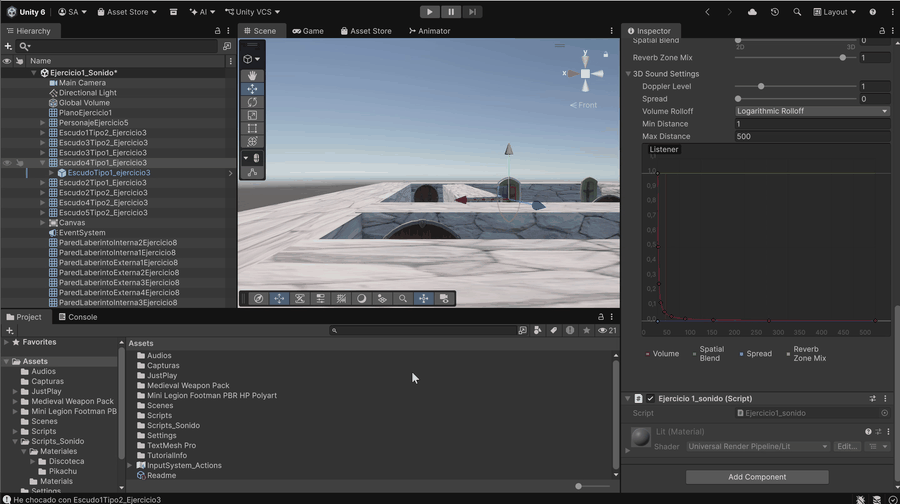

# Practica9_CamaraMicroUnity

En esta práctica se ha trabajado con los componentes de entrada multimedia de Unity, concretamente con el sonido, el micrófono y la cámara (webcam). El objetivo principal ha sido aprender a capturar audio e imagen en tiempo real desde los dispositivos del ordenador y reproducirlos o almacenarlos dentro de una escena 3D.

## Ejercicio 1

Para este primer ejercicio se reutilizó la escena de los guerreros y se añadió un componente `AudioSource` con uno de los clips de audio de la práctica (desactivando *Play On Awake* para que no sonara al iniciar la escena). 

Mediante el script `Ejercicio1_sonido`, se programó el evento de colisión `OnTriggerEnter` para detectar el momento en el que el guerrero alcanza el objetivo y ejecutar `audioSource.Play()`, reproduciendo el sonido en ese instante.

  

## Ejercicio 2

En el segundo ejercicio se montó una escena en una sala con una pantalla central, dos altavoces laterales y una ambientación con varios Pikachu bailando junto a una luz dinámica (`LuzDiscoteca`). 

Para gestionar el audio se creó el script `Ejercicio2_Altavoces`, que detecta el micrófono disponible con `Microphone.devices` y lo vincula al `AudioSource` de los altavoces. Al mantener pulsada la tecla **R** se inicia la grabación con `Microphone.Start`, y al soltarla se detiene con `Microphone.End` para reproducir automáticamente lo grabado por los altavoces.

  

## Ejercicios 3, 4 y 5

Para estos tres últimos ejercicios se utilizó la pantalla principal de la escena (`PantallaReal`) junto con el script `Ejercicio3_TV` para gestionar la webcam mediante la clase `WebCamTexture`:

* **Ejercicio 3:** Se obtuvo el material de la pantalla a través de su componente `Renderer` para asignarle la textura de la cámara (`mainTexture`). Al pulsar la tecla **S** se inicia la captura y se muestra la imagen en directo en el televisor con `Play()`, mientras que al pulsar **P** se pausa la reproducción mediante `Pause()`.
* **Ejercicio 4:** Al arrancar la escena, el script consulta las cámaras conectadas usando `WebCamTexture.devices` y muestra por la consola de Unity el nombre del dispositivo seleccionado con `Debug.Log`.
* **Ejercicio 5:** Se implementó la captura de fotogramas aislados al pulsar la tecla **X**. Para ello se crea una textura `Texture2D` con las dimensiones de la cámara, se copian los píxeles actuales mediante `GetPixels()` y `Apply()`, y se codifica la imagen con `EncodeToPNG()` para guardarla en disco dentro de la carpeta `Assets/Capturas/`.

  

